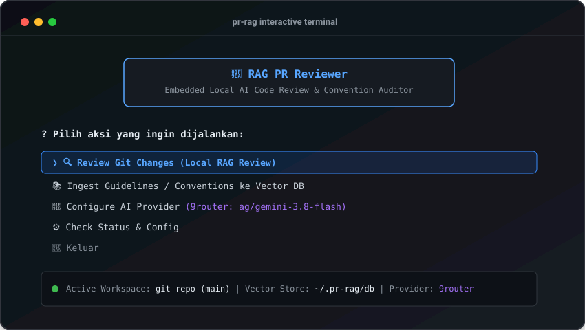
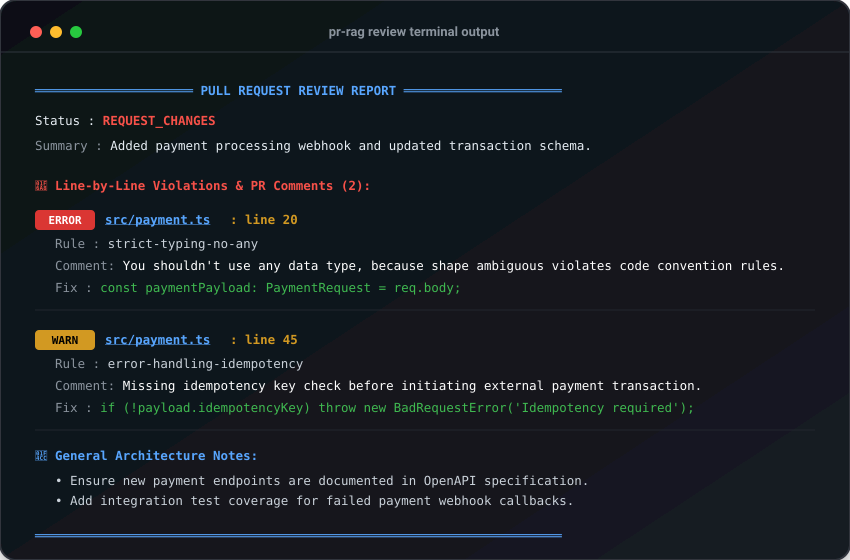

# rag-pr-reviewer (`pr-rag`)

AI-powered local Pull Request reviewer with **embedded RAG** ([LanceDB](https://lancedb.com/)) & **Interactive Terminal UI (TUI)**.

Detects code convention violations and produces actionable, line-by-line PR comments directly in your terminal before code is pushed.

---

## 📸 Screenshots

### 1. Interactive Terminal UI (TUI Mode)
Navigate seamlessly using arrow keys to review git changes, ingest new markdown guidelines, or switch AI providers on the fly.



### 2. Line-Level Convention Audit & PR Comments
Clear, color-coded terminal reports mapping exact violations (`file.ts : line 20`) with rule violations and suggested fixes.



---

## ✨ Key Features

- **🚀 100% Local Execution**: Runs entirely on your machine. Zero external servers or Docker required.
- **📚 Embedded RAG Engine**: Indexes internal team standards, guidelines, and architecture rules locally via LanceDB (`~/.pr-rag/db`).
- **📍 Precise Line-Level Audit**: Identifies exact files and line numbers (`file.ts : line 20`) violating conventions.
- **🤖 Multi-Provider AI Support (Configurable in TUI)**:
  - **9router** (Gateway `ag/gemini-3.8-flash`, `ag/gpt-4o`, etc.)
  - **OpenAI Official** (`gpt-4o`, `o3`, etc.)
  - **OpenRouter** (`anthropic/claude-3.5-sonnet`, etc.)
  - **Ollama** (Local LLM `qwen2.5-coder`, `deepseek-coder`, etc.)
  - **Custom OpenAI-Compatible Provider**
- **🖥️ Dual Mode (Interactive TUI & Fast CLI)**:
  - Interactive terminal menu with arrows & masked password inputs.
  - Command-line flags (`--staged`, `--branch`, `--json`) for quick scripts and pipelines.
- **🧩 Smart Heading Chunker**: Keeps markdown rule contexts intact by chunking along headings (`#`, `##`, `###`).

---

## ⚡ Quick Install & Uninstall (No Git Clone Required)

### 1. One-Liner Install
```bash
curl -fsSL https://raw.githubusercontent.com/jagoankode/rag-pr-reviewer/main/install.sh | bash
```
*Or install globally via npm:*
```bash
npm install -g git+https://github.com/jagoankode/rag-pr-reviewer.git
```

### 2. Configure AI Provider
Simply run `pr-rag` and select **"🤖 Configure AI Provider"** from the interactive menu.
Your settings (API Key, Base URL, Default Model) are securely saved to `~/.pr-rag/config.json`.

*(Alternatively, you can export `OPENAI_API_KEY` and `OPENAI_BASE_URL` in your terminal shell).*

### 3. Uninstall
```bash
curl -fsSL https://raw.githubusercontent.com/jagoankode/rag-pr-reviewer/main/uninstall.sh | bash
# or: npm uninstall -g rag-pr-reviewer
```

---

## 🎮 How to Use

### 1. Interactive TUI Mode (Recommended)
Simply type `pr-rag` anywhere inside a git repository:
```bash
pr-rag
# or
pr-rag ui
```
You will be greeted with an interactive terminal menu:
- 🔍 **Review Git Changes**: Select between uncommitted changes, staged changes, or compare branch.
- 📚 **Ingest Guidelines**: Provide a path to markdown documents to update your local vector index.
- 🤖 **Configure AI Provider**: Switch providers (9router, OpenAI, OpenRouter, Ollama) and update API keys.
- ⚙️ **Check Status & Config**: Verify Git status, LanceDB path, active provider, and API key status.

---

### 2. Direct CLI Commands

#### Ingest Guidelines into Vector DB
```bash
# Ingest single markdown document or entire docs folder
pr-rag ingest ./docs/coding-conventions.md
pr-rag ingest ./docs
```

#### Run Reviews
```bash
# Review uncommitted changes
pr-rag review

# Review only staged changes (git add)
pr-rag review --staged

# Review changes against another branch
pr-rag review --branch main

# Specify a custom model or limit retrieved chunks
pr-rag review --branch main --model ag/gemini-3.8-flash --limit 7

# Output machine-readable JSON
pr-rag review --json
```

---

## 🛠️ Architecture

```text
rag-pr-reviewer/
├── assets/
│   ├── tui-preview.svg            # TUI interface visual mock
│   └── review-report-preview.svg  # Terminal line audit visual mock
├── src/
│   ├── commands/
│   │   ├── ingest.ts       # Parses markdown -> chunks -> embeds -> stores in LanceDB
│   │   ├── review.ts       # Parses diff -> searches rules -> structured LLM audit -> terminal report
│   │   └── tui.ts          # Interactive Terminal UI (Inquirer + Boxen)
│   ├── core/
│   │   ├── chunker.ts      # Markdown section chunking engine
│   │   ├── config.ts       # AI Provider config manager (~/.pr-rag/config.json)
│   │   ├── db.ts           # Embedded LanceDB vector storage (~/.pr-rag/db)
│   │   ├── diff-parser.ts  # Git diff line-by-line annotator
│   │   ├── git.ts          # Git CLI execution helpers
│   │   ├── prompt.ts       # Strict convention audit prompt builder
│   │   └── schema.ts       # Zod structured output schema (File, Line, Rule, Severity)
│   └── index.ts            # CLI & TUI entrypoint
├── install.sh              # One-liner global installation script
├── uninstall.sh            # Global uninstallation & vector cleanup script
├── tsconfig.json
└── package.json
```

---

## 📄 License

ISC © [jagoankode](https://github.com/jagoankode)
